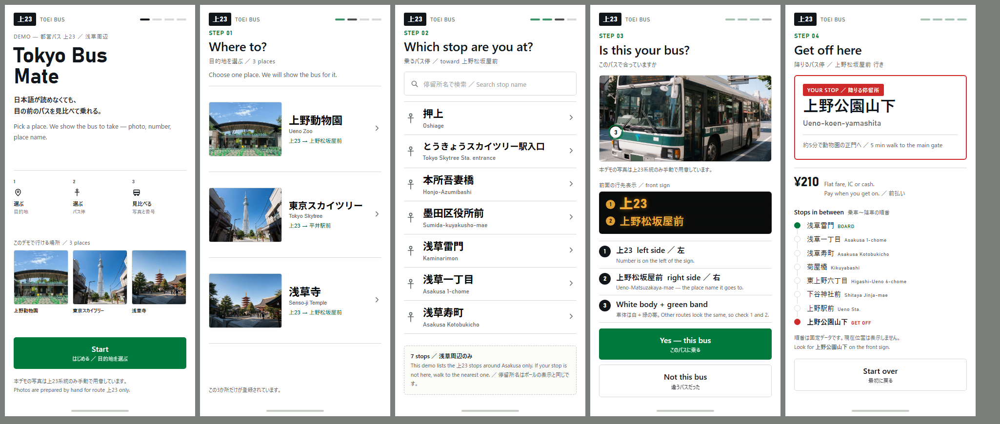

# Tokyo Bus Mate — Demo

日本語が苦手な訪日外国人観光客のための、都営バスの「乗る・降りる」判断支援 Web アプリ（Demo / プロトタイプ）。

対象は **都営バス 上23系統 ／ 浅草周辺** に限定。データは静的データのみで、リアルタイム位置・GPS・画像認識は使いません。
画面は「写真・数字・ローマ字」を優先し、文字量を最小限にしています。



**ブラウザで動く Demo：** https://joyaku.github.io/Tokyo-Bus-Mate-Demo/

## Demo でできること

1. **目的地を選ぶ** — 上野動物園 / 東京スカイツリー / 浅草寺
2. **乗るバス停を選ぶ** — 浅草周辺7停留所。近くに停留所が複数ある場合の誤選択対策として**検索ボックス**つき（漢字・ローマ字の両方で絞り込み）
3. **目の前のバスを3点で照合** — ①系統番号「上23」（行先表示の左）②行先文字（右）③白＋緑の車体。写真の印と文章を同じ順序で提示し、似た車体・逆方向のバスとの誤認を減らす
4. **降りるバス停を確認** — 日本語＋ローマ字で大きく表示、徒歩案内、¥210（均一・前払い）、乗車から降車までの停留所順

## 起動方法

`Tokyo Bus Mate デモ.html` をブラウザで開くだけ（外部ライブラリ・ビルド不要、単一 HTML）。
`assets/` フォルダを同じ階層に置いてください。

| 幅 | 表示 |
|---|---|
| 〜979px | スマートフォン全画面（375px 基準で設計） |
| 980px〜 | 左に説明パネル＋392×844 の端末フレーム |

## Demo に入れていない機能（将来版）

- GTFS-RT によるリアルタイムバス位置
- GPS 現在地取得／現在地からの徒歩案内
- 残り停留所数の降車カウントダウン
- 多言語切替（表示は英語主体＋日本語併記で固定）
- プッシュ通知・音声通知
- **自動画像認識（AI カメラ）** — 照合は人間が目で行う前提のガイドのみ

## ファイル

```
Tokyo Bus Mate デモ.html      デモ本体（単一ファイル）
Tokyo Bus Mate Demo 仕様書.md  画面一覧・ワイヤーフレーム・遷移図・注意点・将来機能・企画考察
assets/                       車体・上野動物園・スカイツリー・浅草寺の写真
preview.png                   5画面のプレビュー
```

## 写真データについて

本デモの写真は上23系統のみ手動で用意した素材です（実運用では撮影・権利確認が必要）。
`assets/` 内の同名ファイルを差し替えれば画面に反映されます。

## 出典（停留所・運賃の静的データ）

- 都営バス のりば案内（上野・本所吾妻橋・平井）
- 都営バス路線検索（上23系統）
- 浅草寺 公式案内
