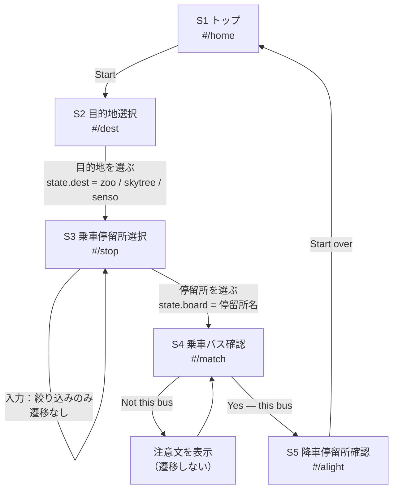

# Tokyo Bus Mate — Demo 仕様書（第4版・Web版／端末別最適化＋4言語）

対象：都営バス **上23系統** ／ 浅草周辺 ／ 訪日外国人（日本語が読めない・英語も得意でない層）
成果物：`Tokyo Bus Mate デモ.html`（単一ファイル・ブラウザで開くだけで動作）＋ `assets/` 5枚（写真4枚＋ロゴ）

> **第3版からの変更点（本版）**
> 1. **端末ごとに別設計**：PC（レール＋2カラムで「並べて見る」）／タブレット（ステップバー＋2カラム）／スマホ（写真主役の縦1列＋サムネイル型リスト）を、単なる縮小ではなく**それぞれの使い方に合わせて作り分け**た。
> 2. **JA／EN／ZH／KO の4言語切替**をヘッダーに追加。切替えると**選択内容（目的地・乗車停留所）を保ったまま**全画面の文言が入れ替わる。
> 3. 端末差・言語差で崩れないよう、`900px`／`640px` の断点を追加し、S4の操作ボタンが③の説明を隠さない位置に再配置。
> 4. 前版までの「多言語切替は Demo に入れない」という制約は、**今回の指示により解除**（§5・§8 に明記）。
>
> 第3版の変更点：端末フレーム（392×844）を廃止し Web 版面へ／ロゴをヘッダー・トップ・favicon に配置／配色をロゴ由来のネイビー＋琥珀に統一。

---

## 0. このDemoの立ち位置（1行）

経路検索アプリ（NAVITIME等）が「出発前にルートを調べる」道具なのに対し、本Demoは**バス停に立っている瞬間・バスが目の前に来た瞬間・降りる準備をする瞬間**の「目視確認」だけを支援する。

### 0.5 ブランド（ロゴと配色）

| 要素 | 仕様 |
|---|---|
| ロゴ | 円形バッジ（ネイビーのリング＋バスのシルエット＋琥珀の「東京」板）。`assets/logo.png`（222×217、背景は近白 `#FDFDFD`）を円形マスクで表示。ヘッダーは PC 46px／スマホ 36px、トップ画面232px（スマホでは非表示）、favicon 兼用 |
| 主色 | ネイビー `#0B2747`（ロゴのリング／ボタン／見出し／現在ステップ） |
| 強調色 | 琥珀 `#DFA440`（ロゴの「東京」板／LEDパネル） |
| 下地 | 紙 `#F4F5F1`、カード面 `#FFFFFF`、罫線 `#D9DED7`、墨 `#151B21` |
| 警告 | 赤 `#CF2A2A`（降車停留所の枠のみ） |
| 字体 | `Bahnschrift`（数字・ローマ字・言語コードの標識感）＋ `Yu Gothic UI` 系（日本語）。外部フォントなし |

> 緑（都営の車体色）は**画面の装飾色としては使わない**。緑は「車体の事実（白＋緑の帯）」として③の文章にだけ残す。

---

## 1. 画面一覧

| # | 画面 | ルート | 目的 | 主な表示要素 | ボタン／操作 |
|---|---|---|---|---|---|
| S1 | トップ | `#/home` | サービスを1画面で説明し、迷わず開始させる | ヘッダー（ロゴ＋サービス名＋`上23`＋**言語切替**）／見出し「乗るバスを、写真で見比べる。」／1行説明／`Start`／ロゴ（PC のみ）／行ける場所3枚（1:1）／写真注釈 | `Start` → S2／言語切替 |
| S2 | 目的地選択 | `#/dest` | 3つの登録観光地から行き先を決める | STEP01／「Where to?」／目的地カード3枚（写真4:3＋**その言語の場所名**＋日本語名（JA時は英語名）＋`上23 → 行先`） | カードクリック → S3（`dest`を保存） |
| S3 | 乗車停留所選択 | `#/stop` | 今いるバス停を、**検索**して選ぶ（近接停留所の誤選択対策） | STEP02／「Which stop are you at?」／行先の向き／**検索ボックス**／停留所カード（漢字＋ローマ字）／候補数のピル／ポール照合のヒント（候補5件以下のときのみ） | 検索入力で絞り込み／カードクリック → S4（`board`を保存） |
| S4 | 乗車バス確認（コア） | `#/match` | 目の前のバスが乗るべきバスかを**3点照合**で判断する | 車体写真（4:3・③の印つき）／前面行先表示の再現（①上23・②行先）＋**行先の現地語注記**（JA以外）／【見分けポイント】3項目／逆方向バスの注意 | `Yes` → S5／`Not this bus` → 注意文を表示（遷移しない） |
| S5 | 降車停留所確認 | `#/alight` | 車内で降りる停留所を日本語＋ローマ字で照合する | STEP04／「Get off here」／赤枠の降車停留所（日本語最大50px＋ローマ字）＋徒歩案内＋¥210／乗車→降車の停留所順（固定データ） | `Start over` → S1（状態リセット） |

**共通コントロール（ヘッダー右）**：`上23` プレート＋言語切替 `JA / EN / ZH / KO`（現在言語はネイビーで塗りつぶし、`aria-pressed` 付き）。

補足：PC では画面左の**レール**（幅264px・スクロール追従）に4ステップ（01目的地／02乗るバス停／03バスを見比べる／04降りるバス停）と「選んだ内容（目的地・乗車停留所）」を常時表示し、現在の画面のみ濃色チップ。番号（STEP01〜04）は**実際の操作順**にのみ使用。タブレット・スマホではレールを**4分割の進捗バー＋現在ステップ名＋`n / 4`** の1行に置き換える。

---

## 2. テキストワイヤーフレーム（PC版面／1180px コンテナ）

```
┌────────────────────────────────────────────────────────────────────────────┐
│ (ロゴ46) Tokyo Bus Mate                                 [上23] [JA|EN|ZH|KO] │ ← ヘッダー（sticky）
│          都営バス 上23 ／ 浅草周辺 ／ Demo                                  │
├──────────────────┬─────────────────────────────────────────────────────────┤
│ FLOW             │                                                         │
│ 01 目的地        │                                                         │
│ 02 乗るバス停    │            STAGE（可変幅・最大860px）                    │
│ 03 バスを見比べる│                                                         │
│ 04 降りるバス停  │                                                         │
│                  │                                                         │
│ 選んだ内容       │                                                         │
│ 目的地  ○○       │                                                         │
│ 乗車停留所 ○○    │                                                         │
│                  │                                                         │
│ 固定データのみ   │                                                         │
├──────────────────┴─────────────────────────────────────────────────────────┤
│ 本デモの写真は上23系統のみ手動で…      STATIC GTFS ／ ¥210 FLAT ／ NO GPS … │ ← フッター
└────────────────────────────────────────────────────────────────────────────┘
```

S1 トップ（PC）

```
│ DEMO — 都営バス 上23 ／ 浅草周辺                                          │
│                                                                          │
│ 乗るバスを、                                   ┌───────────────┐           │
│ 写真で見比べる。                               │  (ロゴ 232px) │           │
│                                                │ TOKYO BUS MATE│           │
│ 日本語が読めなくても、目の前のバスを見比べて乗れる。└───────────────┘         │
│ 目的地を選ぶと、乗るバス停と降りるバス停を案内します。                     │
│ ┌──────────────────────┐                                                 │
│ │ Start ／ はじめる    │  52px                                             │
│ └──────────────────────┘                                                 │
│ ─────────────────────────────────────────────────────────────────────     │
│ このデモで行ける場所                              3 PLACES · 上23 ONLY     │
│ ┌────────┐ ┌────────┐ ┌────────┐                                          │
│ │ 写真1:1│ │ 写真1:1│ │ 写真1:1│                                          │
│ └────────┘ └────────┘ └────────┘                                          │
│ 上野動物園  東京スカイツリー  浅草寺                                       │
│ 本デモの写真は上23系統のみ手動で用意しています。                           │
```

S2 目的地選択（PC 3列／スマホはサムネイル型リスト）

```
│ STEP 01 / 04                                                              │
│ Where to?                                                                 │
│ ┌─────────────┐  ┌─────────────┐  ┌─────────────┐                         │
│ │  写真 4:3   │  │  写真 4:3   │  │  写真 4:3   │                         │
│ ├─────────────┤  ├─────────────┤  ├─────────────┤                         │
│ │ 上野動物園  │  │東京スカイツリー│ │ 浅草寺      │                         │
│ │ Ueno Zoo    │  │ Tokyo Skytree│ │ Senso-ji    │                         │
│ │ 上23 → 上野 │  │ 上23 → 平井  │ │ 上23 → 上野 │                         │
│ └─────────────┘  └─────────────┘  └─────────────┘                         │
```

S3 乗車停留所選択（PC 2列／スマホ 1列）

```
│ STEP 02 / 04                                                              │
│ Which stop are you at? ／ 乗るバス停 ／ 上23 上野松坂屋前 行き              │
│ ┌───────────────────────────────────────────┐                             │
│ │ [虫めがね] 停留所名で検索 ／ Search stop name│  ← 幅560px                │
│ └───────────────────────────────────────────┘                             │
│ ┌───────────────────────┐ ┌───────────────────────┐                       │
│ │ ♜ 押上              > │ │ ♜ とうきょうスカイツリー│                       │
│ │   Oshiage             │ │   駅入口              > │                       │
│ │   …                   │ │   …                   │                       │
│ (7 stops ／ 浅草周辺のみ) (行き先の向きで候補を絞っています)                 │
  ※候補が5件以下のときは「ポールの名前と合わせる」ヒントを追加
```

S4 乗車バス確認（PC 2カラム：写真と3点を並べる）

```
│ STEP 03 / 04                                                              │
│ Is this your bus?                                                         │
│ ┌───────────────────────────────┐  前面の行先表示 ／ front sign           │
│ │        車体写真 4:3      (③)  │  ┌───────────────────────────────────┐│
│ │                               │  │ (①) 上23                          ││
│ └───────────────────────────────┘  │ (②) 上野松坂屋前                  ││
│ 本デモの写真は上23系統のみ手動で…   └───────────────────────────────────┘│
│                                     上野松坂屋前 / Ueno-Matsuzakaya-mae   │
│                                     — Ueno Matsuzakaya dept. store  ※JA以外│
│                                     ① 上23 — 左 ／ 番号は表示の左側        │
│                                     ② 行先 — 右 ／ 行先文字は右側          │
│                                     ③ 白い車体＋緑の帯 ／ ①②で確定        │
│                                     [ このバスに乗る ] [ 違うバスだった ]  │
│                                     （Not this bus で赤い注意文が開く）     │
```

S5 降車停留所確認（PC 2カラム）

```
│ STEP 04 / 04                                                              │
│ Get off here                                                              │
│ ┏━ 赤枠 ━━━━━━━━━━━━━━━━━━━━┓    乗車〜降車の順番                        │
│ ┃ 降りる停留所               ┃    ● 浅草雷門            乗車              │
│ ┃ 上野公園山下               ┃    ○ 浅草一丁目  Asakusa 1-chome           │
│ ┃ Ueno-koen-yamashita       ┃    ○ …                                    │
│ ┃ 約5分で動物園の正門へ      ┃    ● 上野公園山下        降車              │
│ ┗━━━━━━━━━━━━━━━━━━━━━━━━━┛    順番は固定データ。現在位置は出しません     │
│ ¥210 均一運賃。IC か現金。／乗るときに支払います（前払い）。                │
```

### 端末別の作り分け（単なる縮小ではない）

| 幅 | 想定シーン | 版面の判断 |
|---|---|---|
| **1081px 以上（PC）** | 教室・PCで説明しながら見る／複数人で画面を覗く | レール（4ステップ＋選んだ内容）を左に固定。S4・S5は**2カラム**にして「写真と3点」「停留所と順序」を**視線移動だけで照合**できるようにする。目的地3列・停留所2列で一覧性を優先 |
| **901–1080px（小型PC・タブレット横）** | ノートPCの小さい画面／タブレット横持ち | レールを**1行の進捗バー**（4分割バー＋ステップ名＋`n / 4`）に置換。本文は1カラム、S4・S5はまだ2カラム（写真と3点が同一視野に入る幅があるため） |
| **641–900px（タブレット縦）** | バス停でタブレットを縦に持つ | S4・S5を**1カラム**に。写真→LED→3点→ボタンの順で縦に読む |
| **640px 以下（スマホ）** | バス停・車内で**片手**で持つ | ヘッダーを圧縮（副題を隠す・ロゴ36px・言語ボタン小型化）。トップの大ロゴを外して写真へ視線を移す。目的地は**左サムネイル（104px）＋右テキスト**のリストにして3件が1画面に収まるようにする。停留所は1列・行高64px以上。S4は写真フル幅→LED→3点→ボタンの順で、**ボタンは③の説明より後**に置く（追従バーにすると③が隠れるため） |

---

## 3. 画面遷移図



| 遷移 | 条件 | 保持する状態 | 備考 |
|---|---|---|---|
| S1 → S2 | Start | — | — |
| S2 → S3 | 目的地カードのクリック | `dest`（zoo／skytree／senso） | 選んだ目的地で「乗れる停留所」と「降車停留所」が決まる |
| S3 → S3 | 検索入力 | — | ページを再描画しないためフォーカスが落ちない |
| S3 → S4 | 停留所カードのクリック | `board`（停留所名） | — |
| S4 → S5 | Yes — this bus | `dest` / `board` | 降車停留所と停留所順を確定 |
| S4 → S4 | Not this bus | — | 逆方向バスの注意文（同じ車体・行先だけ違う） |
| S5 → S1 | Start over | 初期化 | 状態をリセット |
| 任意 → 同画面 | **言語切替（JA／EN／ZH／KO）** | `dest` / `board` を保持 | 文言のみ差し替え。画面位置は変わらない |
| 任意 → S1 | ヘッダーのロゴ | 初期化 | ロゴがホームリンクを兼ねる |

実装：`location.hash` による単純ルーター（`#/home` 等）。状態は `{dest, board, lang}` の3値のみ。ブラウザの戻る／進むもそのまま効く。

---

## 4. 各画面の注意点

| 画面 | 注意点（画面設計上の判断） |
|---|---|
| S1 | 文字は「日本語1行＋説明1行」に絞り、判断材料は3枚の写真に寄せる。写真の下に手動作成の注釈を必ず置き、実データと誤解させない。スマホでは大ロゴを外し、写真が画面の主役になるようにする。 |
| S2 | 目的地は**写真・場所名・もう一方の言語の名前・行先の4点**だけ。路線名や運賃は出さない。場所名は**その言語の表記**（例：ZHなら「上野动物园」）、副題に日本語名を残して**現地の看板と結びつく**ようにする。 |
| S3 | 近くに停留所が複数ある場合の誤選択が課題なので、**常時見える検索ボックス**を一覧の直上に固定。検索対象は日本語名＋ローマ字の両方。0件時は「一致なし＋全件に戻す」案内。**停留所名はどの言語でも日本語のまま**（現場の標識と一致させるため）。 |
| S4 | **写真だけに判別を委ねない**。①系統番号（左）②行先文字（右）③車体の色を、番号付きで写真・LEDパネルに重ね、同じ順序で文章でも繰り返す。**AI・カメラによる自動判定は行わない**。LEDの行先は**日本語のまま**出し、JA以外のときは直下に現地語の注記を1行だけ添える（例：ZH「上野松坂屋百货前」）。 |
| S5 | 降車停留所は日本語（最大50px）＋ローマ字の2段で最も大きく。運賃は¥210・前払いのみ補足。停留所順は**固定データの並び**で、現在位置・残り数・カウントダウンは出さない（画面内に注記）。ローマ字は**日本語名の下に改行して置く**（長い駅名で折り返して読みにくくならないように）。 |

**共通**：本文14px以上／検索入力16px／クリック領域 高さ52px以上（スマホの停留所行は64px以上）／絵文字なし／外部ライブラリ・Webフォントなし／配色はロゴ由来のネイビー＋琥珀＋墨＋紙＋赤／キーボードのフォーカスリング（ネイビー2px）を明示／`prefers-reduced-motion` でアニメーション停止／`<html lang>` を選択言語に合わせて更新。

---

## 5. Demoに入れない将来機能（混入防止）

| 将来機能 | 本Demoの扱い | 確認方法 |
|---|---|---|
| GTFS-RTによるリアルタイムバス位置 | 実装しない。データは静的配列のみ | `GTFS-RT` は「使用しない」旨のコメント1行のみ |
| GPS現在地取得・現在地からの徒歩案内 | 実装しない（位置APIを一切呼ばない） | `navigator.geolocation` 不在 |
| 残り停留所数の降車カウントダウン | 実装しない。停留所順は**静的リスト**で、現在位置の強調も残数表示もしない | `残り`・`カウントダウン` の表示なし |
| **多言語切替** | **本Demoでは実装（指示により制約を解除）**。JA／EN／ZH／KO の4言語。ただし**停留所名・LED行先・系統番号は日本語のまま**（現場照合の対象だから） | ヘッダーの `JA EN ZH KO` で切替／文言表 `I18N` の4言語定義 |
| プッシュ通知・音声通知 | 実装しない | `Notification` / `Audio` 不在 |
| **自動画像認識（AIカメラ）** | **実装しない**。写真は目視照合用の静止画のみ | カメラAPI・推論呼び出し・「AIが判定」文言なし |

画面に出してよいのは「静的な事実（停留所名・順番・運賃）」と「目視照合のガイド」だけ。**動的な現在地・残数・推定は一切出さない。**（フッターの `NO GPS · NO LIVE DATA · NO AI CAMERA` は、実装していないことの宣言であって機能ではない）

> 注記：第2版・第3版では「多言語切替は Demo に入れない」としていたが、**利用者からの明示的な指示により本版で実装**した。この変更は §1（ヘッダーの言語切替）、§7（文言表）、§8（実装メモ）に反映済み。

---

## 6. 企画の補足考察

**(1) 写真収集のコストと地域拡大の課題。** 写真を1路線ぶん揃えるだけでも、車体（前面・側面）と行先表示の組合せを、方向別・時間帯別に撮り分ける必要があり、撮影は停留所での待ち時間と天候に左右される。上23系統のように方向が2つある路線では「同じ車体で行先だけ違う」写真を両方そろえなければならず、枚数は路線数×方向数×車体バリエーションで増え、撮り直しのたびに人が現地へ行くコストが発生する。地域を広げると、①路線ごとに停留所名・順番・運賃・降車後の徒歩案内を個別に整備する作業、②撮影許可や写り込み（乗客・運転士）への配慮、③似た車体が増えるほど「見分けポイント」を路線ごとに書き直す必要、が重なり、手作業のままでは拡大速度が撮影者数に律速される。現実的なのは、撮影を一度で済ませるための「撮影リスト（構図・方向・表示状態の指定）」を標準化し、更新は差分だけにすること、そして写真が未整備の路線では写真を出さず「番号＋行先＋色」の3点テキスト照合に自動的に切り替えることだ。

**(2) 英語が苦手な利用者への配慮。** ①英文を短い命令文（`Take this bus` など）に限り、長い説明を出さない、②判断は「番号・矢印・色」の視覚要素を先に出し、文字は補助に下げる、③日本語は現場で必ず目にする形（漢字＋ローマ字、看板と同じ順序）で見せる、④`Not this bus`のように**間違えたときに次の行動が分かる**文言を必ず添える、の4点を設計原則とする。読み解く力を要求するのではなく、現場の対象物と画面を1対1で突き合わせられる状態に保つことが、この層に対する最大の配慮になる。

**(3) 4言語化に伴う線引き（今回追加）。** 翻訳するのは「**操作と判断を説明する文**」だけに限定し、**停留所名・前面LEDの行先・系統番号は日本語のまま**残した。ここまで翻訳してしまうと、画面の文字と現場の標識が一致しなくなり、照合という本サービスの価値そのものが壊れるためである。その代わり、JA以外の言語ではLEDの直下に現地語の注記を1行だけ添え（例：ZH「上野松坂屋百货前」）、「読めない文字が何を指しているか」は補う。また、言語は日本語・英語・中国語（簡体）・韓国語の4つに絞った。対象市場の visitor 数と、停留所名の英語表記が既に現地で通用していることを踏まえた選択で、繁体字や他の言語への拡張は、まず写真と「見分けポイント」の整備が済んだ路線で行う。

---

## 7. データ定義（HTML内に固定値として保持）

### 目的地（`DATA`）

| key | 日本語 | English | 中文 | 한국어 | 行先（方向） | 降車停留所 | 徒歩 |
|---|---|---|---|---|---|---|---|
| `zoo` | 上野動物園 | Ueno Zoo | 上野动物园 | 우에노 동물원 | 上野松坂屋前／Ueno-Matsuzakaya-mae | 上野公園山下／Ueno-koen-yamashita | 約5分で正門 |
| `skytree` | 東京スカイツリー | Tokyo Skytree | 东京晴空塔 | 도쿄 스카이트리 | 平井駅前／Hirai Sta. | 押上／Oshiage | 約5分 |
| `senso` | 浅草寺 | Senso-ji Temple | 浅草寺 | 센소지 | 上野松坂屋前／Ueno-Matsuzakaya-mae | 浅草雷門／Kaminarimon | 降車してすぐ |

### 停留所（都営バス公開情報にもとづく固定値・**全言語で日本語表記のまま**）

- `ROUTE_UE`（上野松坂屋前 行き・13停留所）：押上 → とうきょうスカイツリー駅入口 → 本所吾妻橋 → 墨田区役所前 → 浅草雷門 → 浅草一丁目 → 浅草寿町 → 菊屋橋 → 東上野六丁目 → 下谷神社前 → 上野駅前 → 上野公園山下 → 上野松坂屋前
- `ROUTE_HR`（平井駅前 行き・6停留所）：浅草雷門 → 墨田区役所前 → 本所吾妻橋 → とうきょうスカイツリー駅入口 → 押上 → 十間橋
- `AREA`（乗車候補に出す浅草周辺7停留所）：浅草雷門／浅草一丁目／浅草寿町／墨田区役所前／本所吾妻橋／とうきょうスカイツリー駅入口／押上
- 運賃：¥210（均一・前乗り前払い）

### 乗車候補の絞り込み（`boardStops(dest)`）

1. 選んだ目的地の**行先方向の路線**（`route`）を取る
2. 降車停留所より**手前**の区間だけを残す（逆方向・通過済みの停留所を出さない）
3. その区間と `AREA` の積を取る → 上野動物園 7件／東京スカイツリー 4件／浅草寺 4件

### 検索ボックス（S3）

- 対象：各カードの `data-s`（日本語名＋ローマ字を小文字化した文字列）
- 判定：部分一致・大文字小文字無視（`kaminarimon` でも `雷門` でもヒット）
- 挙動：`input` イベントで**表示カードだけ**を切り替える（`innerHTML` を再構築しない＝フォーカスとカーソル位置を保つ）
- 0件：`一致するバス停がありません ／ 検索を消すと全件に戻ります` を表示
- 表示件数が奇数のときは、最後のカードを横幅いっぱいに広げて1枚だけの行を作らない

### 見分けポイント（S4の中核）

| 番号 | 画面表記（JA例） | 意味 | 現場での照合対象 |
|---|---|---|---|
| ① | `上23 — 表示の左` | 系統番号は行先表示の**左** | 前面LEDの左側の数字 |
| ② | `上野松坂屋前 — 表示の右` | 行先文字は**右**、ローマ字併記 | 前面LEDの右側の文字列 |
| ③ | `白い車体＋緑の帯` | 車体は白＋緑の帯（写真下部に③印） | 車体の色と帯の位置 |

3点を「写真の印 → LEDパネルの印 → 文章」の同じ順序で3回提示し、似た車体でも**番号と行先で確定できる**ようにする。逆方向（同じ白＋緑・行先だけ違う）は `Not this bus` で明示的に警告。

### 言語表（`I18N`・40キー×4言語）

| 区分 | 翻訳する | 翻訳しない（日本語のまま） |
|---|---|---|
| 画面文言 | 見出し・副題・説明・ボタン・注記・運賃・停留所順のラベル・検索プレースホルダ・ステップ名 | — |
| 現地情報 | 観光地の名称、降車後の徒歩案内、LED行先の現地語注記 | 停留所名、LEDの行先文字、系統番号 `上23`、ローマ字表記 |
| 数値・記号 | `¥210`、`01`〜`04`（中文のみゼロ埋めなし）、`①②③` | — |

---

## 8. 実装メモ

- 単一HTML（インラインCSS/JS、外部ライブラリ・Webフォントなし、絵文字なし）。文字は `Bahnschrift`（数字・ローマ字）＋ `Yu Gothic UI` 系（日本語）。
- 版面：`max-width: 1180px` のコンテナに `264px`（レール）＋ `1fr`（ステージ）の2カラム。レールは `position: sticky` でスクロールに追従。ヘッダーとフッターは全幅。
- 断点は **1080px**（レール→1行ステップバー、本文1カラム）／**900px**（S4・S5を1カラム）／**640px**（スマホ専用の圧縮ヘッダー、目的地サムネイルリスト、停留所1列、大ロゴ非表示）。グリッドは `minmax(0,1fr)` と子要素の `min-width:0` を明示し、画像の固有幅でカラムが押し広がらないようにしている。
- **言語切替**：`LANGS` の4言語を `I18N` の文言表（40キー）で持ち、`t(key, vars)` が `{dir}` などのプレースホルダを差し込む。ヘッダーのボタンは1回だけ生成し、`state.lang` を替えて `render()` を呼ぶ。**再描画しても `state.dest` / `state.board` は保持**されるため、確認画面の途中で言語を変えても選択が消えない。選択は `localStorage`（`tbm_lang`）に保存し、`try/catch` で `file://` でも落ちないようにしている。`<html lang>` とストレージ以外の外部依存はなし。
- ステップ表記は `stp(n)` で言語別に整形（中文は「第 1 步 ／ 共 4 步」、他は `01`）。
- ルーター：`location.hash`（`#/home` `#/dest` `#/stop` `#/match` `#/alight`）。`render()` で1画面ずつ描画し、左レール／進捗バー／選択内容／フッターの文言も同時に更新。途中の画面を直接開いた場合は `dest=zoo` と最初の乗車候補を補い、**表示内容と選択カードが食い違わない**ようにしている。
- ロゴ：`assets/logo.png`（ユーザー提供）を**改変せず**、`border-radius:50%` のマスクで近白の四隅を落として円形バッジとして使用。`<link rel="icon" href="assets/logo.png">` でファビコン兼用。
- 画像：`assets/` 配下5枚を**相対パス**で参照（`logo.png` `ueno-zoo.jpg` `skytree.jpg` `sensoji.jpg` `bus-toei.jpg`）。差し替えは同名ファイルを置くだけ。
- 検証：Microsoft Edge headless で、**1440×900（PC5画面）／1024×820（タブレット）／390×844（スマホ・iframeラッパーで実寸）** を撮影して目視確認。加えて自動テストを2本実行し、①4言語×5画面＝20通りの描画でプレースホルダ残り・`undefined` の混入がないこと、②検索ヒット／0件／目的地→乗車→降車の一連遷移／`Not this bus`／言語切替後の状態保持／やり直しの**25項目すべて PASS** を確認した。

### 未確定・要判断（提出時に添える）

1. 車体・スカイツリー・浅草寺の写真は**Demo用に用意した素材**（差し替え前提）。実運用では撮影・権利確認が必要。
2. 言語は4つ（日本語・英語・中国語簡体・韓国語）。初期表示は**日本語**、前回選んだ言語は端末に保存される。中国語を繁体字に、あるいは他の言語を追加する場合は、文言表 `I18N` に1ブロック足すだけで済む構造。
3. ロゴは提供画像をそのまま使用。SVG版や単色版（白抜き）が必要になった時点で、元データからの書き出しを依頼する。
