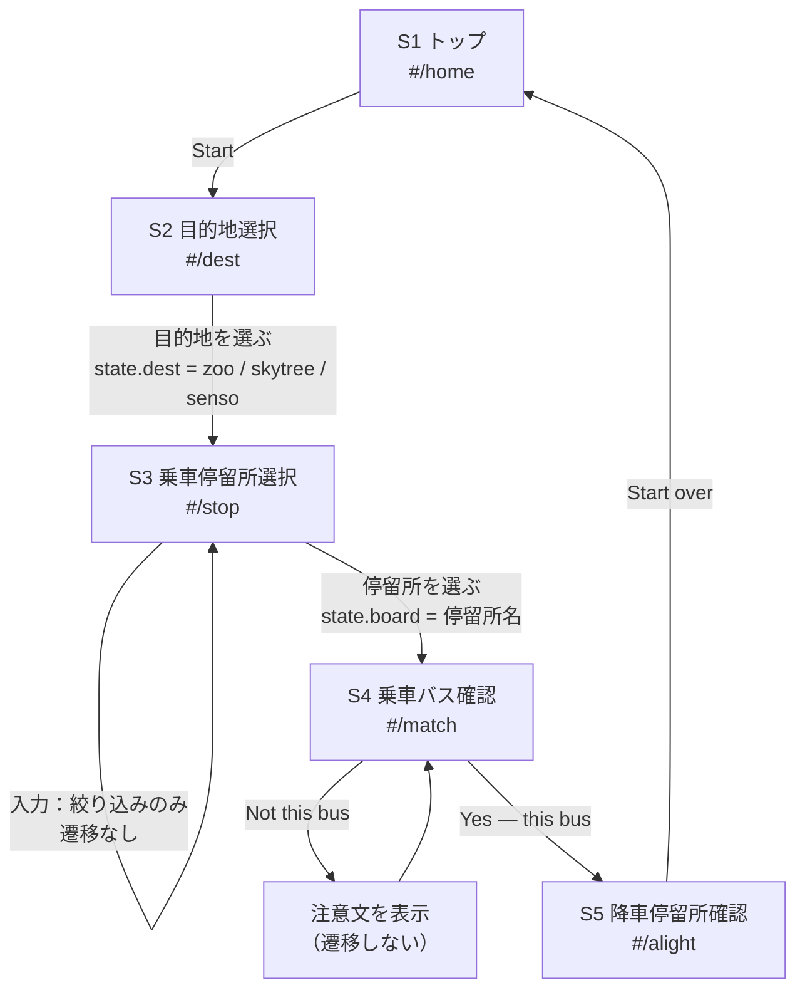

# Tokyo Bus Mate — Demo 仕様書（第2版）

対象：都営バス **上23系統** ／ 浅草周辺 ／ 訪日外国人（日本語が読めない・英語も得意でない層）
成果物：`Tokyo Bus Mate デモ.html`（単一ファイル・ブラウザで開くだけで動作）＋ `assets/` 4枚

> 第1版（目的地2件・検索なし）を、講師フィードバックを反映した正式指示にもとづき全面改訂した版。
> 変更点：目的地を3件に（浅草寺を追加）／乗車停留所に検索ボックス／乗車バス確認に【見分けポイント】／
> 自動画像認識（AIカメラ）を明確に排除／写真データの「手動で用意している」注釈／企画考察（第6項）を追加。

---

## 0. このDemoの立ち位置（1行）

経路検索アプリ（NAVITIME等）が「出発前にルートを調べる」道具なのに対し、本Demoは**バス停に立っている瞬間・バスが目の前に来た瞬間・降りる準備をする瞬間**の「目視確認」だけを支援する。

---

## 1. 画面一覧

| # | 画面 | ルート | 目的 | 主な表示要素 | ボタン／操作 |
|---|---|---|---|---|---|
| S1 | トップ | `#/home` | サービスを1画面で説明し、迷わず開始させる | サービス名／日本語1行の訴求／英語1行の説明／手順3つのアイコン（選ぶ・選ぶ・見比べる）／行ける場所3枚の写真／写真注釈 | `Start` → S2 |
| S2 | 目的地選択 | `#/dest` | 3つの登録観光地から行き先を決める | STEP01／「Where to?」／目的地3行（写真150×112・日本語名・英語名・`上23 → 行先`） | 行タップ → S3（`dest`を保存） |
| S3 | 乗車停留所選択 | `#/stop` | 今いるバス停を、**検索**して選ぶ（近接停留所の誤選択対策） | STEP02／「Which stop are you at?」／行先の向き（`toward 上野松坂屋前`）／**検索ボックス**／停留所行（漢字＋ローマ字）／候補数の注記／ポール照合のヒント（候補5件以下のときのみ） | 検索入力で行を絞り込み／行タップ → S4（`board`を保存） |
| S4 | 乗車バス確認（コア） | `#/match` | 目の前のバスが乗るべきバスかを**3点照合**で判断する | STEP03／車体写真（③の印つき）／写真の手動注釈／前面行先表示の再現（①上23・②行先）／**【見分けポイント】3項目**／逆方向バスの注意（`Not this bus`時） | `Yes — this bus` → S5／`Not this bus` → 注意文を表示（遷移はしない） |
| S5 | 降車停留所確認 | `#/alight` | 車内で降りる停留所を日本語＋ローマ字で照合する | STEP04／「Get off here」／赤枠の降車停留所（日本語32px＋ローマ字）／徒歩案内／¥210・前払い／乗車→降車の停留所順（固定データ） | `Start over` → S1（状態リセット） |

補足：S2〜S5の上部に4分割の進捗バー（現在地のみ濃色、通過済みは緑）。番号（STEP01〜04）は**実際の操作順**にのみ使用。

---

## 2. テキストワイヤーフレーム（390px 幅）

```
S1 トップ #/home
┌──────────────────────────────────────┐
│ [上23][TOEI BUS]          ▬▭▭▭      │ ← 進捗バー(4)
│ DEMO — 都営バス 上23 ／ 浅草周辺      │
│ Tokyo Bus                            │
│ Mate                                 │ 44px / 2行
│ 日本語が読めなくても、                │
│ 目の前のバスを見比べて乗れる。        │ 14px 太字
│ Pick a place. We show the bus to     │
│ take — photo, number, place name.    │
│ ────────────────────────────────     │
│ 1          2          3              │
│ [ピン]     [ポール]   [バス]         │ 手順アイコン
│ 選ぶ       選ぶ       見比べる        │
│ 目的地     バス停     写真と番号      │
│                                      │
│ このデモで行ける場所 ／ 3 places      │
│ [写真]     [写真]     [写真]          │ 1:1 ×3
│ 上野動物園 スカイツリー 浅草寺        │
│                                      │
│ ┌──────────────────────────────┐    │
│ │ Start ／ はじめる 目的地を選ぶ │    │ 56px 緑
│ └──────────────────────────────┘    │
│ 本デモの写真は上23系統のみ手動で…     │ 11px 注釈
└──────────────────────────────────────┘

S2 目的地選択 #/dest
┌──────────────────────────────────────┐
│ STEP 01                              │
│ Where to?                            │
│ 目的地を選ぶ ／ 3 places              │
│ Choose one place. We will show the   │
│ bus for it.                          │
│ ────────────────────────────────     │
│ [写真150] 上野動物園            >    │ 行 176px
│           Ueno Zoo                   │
│           上23 → 上野松坂屋前         │
│ ────────────────────────────────     │
│ [写真]    東京スカイツリー      >    │
│           Tokyo Skytree              │
│           上23 → 平井駅前             │
│ ────────────────────────────────     │
│ [写真]    浅草寺               >     │
│           Senso-ji Temple            │
│           上23 → 上野松坂屋前         │
│ この3か所だけが登録されています。     │
└──────────────────────────────────────┘

S3 乗車停留所選択 #/stop
┌──────────────────────────────────────┐
│ STEP 02                              │
│ Which stop are you at?               │
│ 乗るバス停 ／ toward 上野松坂屋前     │
│ ┌────────────────────────────────┐  │
│ │ [虫めがね] 停留所名で検索…       │  │ ← 検索ボックス
│ └────────────────────────────────┘  │
│  ♜  押上                        >    │ 行 68px
│     Oshiage                          │
│  ♜  とうきょうスカイツリー駅入口 >    │ ※長名は18px
│     Tokyo Skytree Sta. entrance      │
│  ♜  本所吾妻橋 …（全7件・スクロール可）│
│ ┌ dashed ────────────────────────┐  │
│ │ 7 stops ／ 浅草周辺のみ          │  │
│ │ このDemoは浅草周辺の停留所だけ…   │  │
│ └────────────────────────────────┘  │
└──────────────────────────────────────┘
  ※候補が5件以下のとき（=スカイツリー/浅草寺）は
    「ポールの名前と合わせる」ヒントを追加表示

S4 乗車バス確認 #/match（コア）
┌──────────────────────────────────────┐
│ STEP 03                              │
│ Is this your bus?                    │
│ このバスで合っていますか              │
│ ┌────────────────────────────────┐  │
│ │        車体写真（2:1）     (③)   │  │ ← 車体下部に③
│ └────────────────────────────────┘  │
│ 本デモの写真は上23系統のみ手動で…     │
│ 前面の行先表示 ／ front sign          │
│ ┌──── 黒いLEDパネル ───────────────┐ │
│ │ (①) 上23                          │ │ ← ①=系統番号(左)
│ │ (②) 上野松坂屋前                  │ │ ← ②=行先(右)
│ └──────────────────────────────────┘ │
│ ① 上23   left side ／ 左             │
│    番号は表示の左側                  │
│ ② 上野松坂屋前 right side ／ 右       │
│    Ueno-Matsuzakaya-mae — 行き先     │
│ ③ White body + green band            │
│    車体は白＋緑の帯。似ているので①②も見る│
│ ┌──────────────────────────────┐    │
│ │ Yes — this bus このバスに乗る │    │ 56px
│ └──────────────────────────────┘    │
│ ┌ 枠線 ────────────────────────┐    │
│ │ Not this bus 違うバスだった   │    │ → 注意文
│ └──────────────────────────────┘    │
└──────────────────────────────────────┘

S5 降車停留所確認 #/alight
┌──────────────────────────────────────┐
│ STEP 04                              │
│ Get off here                         │
│ 降りるバス停 ／ 上野松坂屋前 行き     │
│ ┏━ 赤枠 ━━━━━━━━━━━━━━━━━━━━━━━━┓  │
│ ┃ YOUR STOP ／ 降りる停留所        ┃  │
│ ┃ 上野公園山下                      ┃  │ 32px
│ ┃ Ueno-koen-yamashita               ┃  │
│ ┃ 約5分で動物園の正門へ              ┃  │
│ ┗━━━━━━━━━━━━━━━━━━━━━━━━━━━━━━━┛  │
│ ¥210  Flat fare, IC or cash.         │
│       Pay when you get on. ／ 前払い  │
│ Stops in between 乗車〜降車の順番      │
│ ● 浅草雷門              BOARD         │
│ ○ 浅草一丁目    Asakusa 1-chome       │
│ ○ 浅草寿町      Asakusa Kotobukicho   │
│ ○ 菊屋橋        Kikuyabashi           │
│ ○ 東上野六丁目  Higashi-Ueno 6-chome  │
│ ○ 下谷神社前    Shitaya Jinja-mae     │
│ ○ 上野駅前      Ueno Sta.             │
│ ● 上野公園山下          GET OFF       │
│ 順番は固定データです。現在位置は表示しません│
│ ┌──────────────────────────────┐    │
│ │ Start over ／ 最初に戻る       │    │
│ └──────────────────────────────┘    │
└──────────────────────────────────────┘
```

---

## 3. 画面遷移図



| 遷移 | 条件 | 保持する状態 | 備考 |
|---|---|---|---|
| S1 → S2 | Start | — | — |
| S2 → S3 | 目的地行のタップ | `dest`（zoo／skytree／senso） | 選んだ目的地で「乗れる停留所」と「降車停留所」が決まる |
| S3 → S3 | 検索入力 | — | ページを再描画しないためフォーカスが落ちない |
| S3 → S4 | 停留所行のタップ | `board`（停留所名） | — |
| S4 → S5 | Yes — this bus | `dest` / `board` | 降車停留所と停留所順を確定 |
| S4 → S4 | Not this bus | — | 逆方向バスの注意文（同じ車体・行先だけ違う） |
| S5 → S1 | Start over | 初期化 | 状態をリセット |

実装：`location.hash` による単純ルーター（`#/home` 等）。状態は `{dest, board}` の2値のみ。

---

## 4. 各画面の注意点

| 画面 | 注意点（画面設計上の判断） |
|---|---|
| S1 | 文字は日本語1行＋英語1行に絞り、判断材料は「3枚の写真」と「3つのアイコン」に寄せる。写真の下に手動作成の注釈を必ず置き、実データと誤解させない。 |
| S2 | 目的地は**写真・日本語名・英語名・行先の3点**だけ。路線名や運賃は出さない（この段階では不要な情報）。行の高さ176pxで写真を主役にする。 |
| S3 | 近くに停留所が複数ある場合の誤選択が課題なので、**常時見える検索ボックス**を一覧の直上に固定。検索対象は日本語名＋ローマ字の両方（読みが分からなくても綴りで辿れる）。0件時は「一致なし＋全件に戻す」案内。候補が少ない目的地では「ポールの名前と合わせる」ヒントを追加し、写真に頼りすぎない。 |
| S4 | **写真だけに判別を委ねない**。①系統番号（左）②行先文字（右）③車体の色、の3点を番号付きで写真・LEDパネル上に重ね、同じ順序で文章でも繰り返す。同じ白＋緑の車体が逆方向にも走るため、`Not this bus`で「行先だけ違う」と明示。**AI・カメラによる自動判定は行わない**（人が目で照合するガイドに限定）。 |
| S5 | 降車停留所は日本語32px＋ローマ字の2段で最も大きく。運賃は¥210・前払いのみを補足。停留所順は**固定データの並び**であり、現在位置・残り数・カウントダウンは出さない（注記を画面内に明記）。 |

**共通**：本文13px以上／タップ行68px以上／ボタン56px／絵文字なし／外部ライブラリなし／配色は墨・紙・緑・琥珀・赤の5色。

---

## 5. Demoに入れない将来機能（混入防止）

| 将来機能 | 本Demoの扱い | 確認方法 |
|---|---|---|
| GTFS-RTによるリアルタイムバス位置 | 実装しない。データは静的配列のみ | `GTFS-RT` は「使用しない」旨のコメント1行のみ |
| GPS現在地取得・現在地からの徒歩案内 | 実装しない（位置APIを一切呼ばない） | `navigator.geolocation` 不在 |
| 残り停留所数の降車カウントダウン | 実装しない。停留所順は**静的リスト**で、現在位置の強調も残数表示もしない | `残り`・`カウントダウン` の表示なし |
| 多言語切替 | 実装しない。表示は「英語主体＋日本語併記」で固定 | 言語切替UIなし |
| プッシュ通知・音声通知 | 実装しない | `Notification` / `Audio` 不在 |
| **自動画像認識（AIカメラ）** | **実装しない**。写真は目視照合用の静止画のみ | カメラAPI・推論呼び出し・「AIが判定」文言なし |

画面に出してよいのは「静的な事実（停留所名・順番・運賃）」と「目視照合のガイド」だけ。**動的な現在地・残数・推定は一切出さない。**

---

## 6. 企画の補足考察（写真収集コスト・地域拡大／英語が苦手な層への配慮）

写真を1路線ぶん揃えるだけでも、車体（前面・側面）と行先表示の組合せを、方向別・時間帯別に撮り分ける必要があり、撮影は停留所での待ち時間と天候に左右される。上23系統のように方向が2つある路線では「同じ車体で行先だけ違う」写真を両方そろえなければならず、枚数は路線数×方向数×車体バリエーションで増え、撮り直しのたびに人が現地へ行く成本が発生する。地域を広げると、①路線ごとに停留所名・順番・運賃・降車後の徒歩案内を個別に整備する作業、②撮影許可や写り込み（乗客・運転士）への配慮、③似た車体が増えるほど「見分けポイント」を路線ごとに書き直す必要、が重なり、手作業のままでは拡大速度が撮影者数に律速される。現実的なのは、撮影を一度で済ませるための「撮影リスト（構図・方向・表示状態の指定）」を標準化し、更新は差分だけにすること、そして写真が未整備の路線では写真を出さず「番号＋行先＋色」の3点テキスト照合に自動的に切り替えることだ。あわせて、英語が得意でない利用者に対しては、①英文を短い命令文（`Take this bus` など）に限り、長い説明を出さない、②判断は「番号・矢印・色」の視覚要素を先に出し、文字は補助に下げる、③日本語は現場で必ず目にする形（漢字＋ローマ字、看板と同じ順序）で見せる、④`Not this bus`のように**間違えたときに次の行動が分かる**文言を必ず添える、の4点を設計原則とする。読み解く力を要求するのではなく、現場の対象物と画面を1対1で突き合わせられる状態に保つことが、この層に対する最大の配慮になる。

---

## 7. データ定義（HTML内に固定値として保持）

### 目的地（`DATA`）

| key | 表示名 | 英語名 | 行先（方向） | 降車停留所 | 徒歩 |
|---|---|---|---|---|---|
| `zoo` | 上野動物園 | Ueno Zoo | 上野松坂屋前／Ueno-Matsuzakaya-mae | 上野公園山下／Ueno-koen-yamashita | 約5分で正門 |
| `skytree` | 東京スカイツリー | Tokyo Skytree | 平井駅前／Hirai Sta. | 押上／Oshiage | 約5分 |
| `senso` | 浅草寺 | Senso-ji Temple | 上野松坂屋前／Ueno-Matsuzakaya-mae | 浅草雷門／Kaminarimon | 降車してすぐ |

### 停留所（都営バス公開情報にもとづく固定値）

- `ROUTE_UE`（上野松坂屋前 行き・13停留所）：押上 → とうきょうスカイツリー駅入口 → 本所吾妻橋 → 墨田区役所前 → 浅草雷門 → 浅草一丁目 → 浅草寿町 → 菊屋橋 → 東上野六丁目 → 下谷神社前 → 上野駅前 → 上野公園山下 → 上野松坂屋前
- `ROUTE_HR`（平井駅前 行き・6停留所）：浅草雷門 → 墨田区役所前 → 本所吾妻橋 → とうきょうスカイツリー駅入口 → 押上 → 十間橋
- `AREA`（乗車候補に出す浅草周辺7停留所）：浅草雷門／浅草一丁目／浅草寿町／墨田区役所前／本所吾妻橋／とうきょうスカイツリー駅入口／押上
- 運賃：¥210（均一・前乗り前払い）

### 乗車候補の絞り込み（`boardStops(dest)`）

1. 選んだ目的地の**行先方向の路線**（`route`）を取る
2. 降車停留所より**手前**の区間だけを残す（逆方向・通過済みの停留所を出さない）
3. その区間と `AREA` の積を取る → 上野動物園 7件／東京スカイツリー 4件／浅草寺 4件

→ 「目の前にあるのに乗れない停留所」を候補に出さないための処理。初期表示の停留所は `浅草雷門`。

### 検索ボックス（S3）

- 対象：`data-s`（日本語名＋ローマ字を小文字化した文字列）
- 判定：部分一致・大文字小文字無視（`kaminarimon` でも `雷門` でもヒット）
- 挙動：`input` イベントで**表示行だけ**を切り替える（`innerHTML` を再構築しない＝フォーカスとカーソル位置を保つ）
- 0件：`No stop matches ／ 一致するバス停がありません` を表示

### 見分けポイント（S4の中核）

| 番号 | 画面表記 | 意味 | 現場での照合対象 |
|---|---|---|---|
| ① | `上23 left side ／ 左` | 系統番号は行先表示の**左** | 前面LEDの左側の数字 |
| ② | `上野松坂屋前 right side ／ 右` | 行先文字は**右**、ローマ字併記 | 前面LEDの右側の文字列 |
| ③ | `White body + green band` | 車体は白＋緑の帯（写真下部に③印） | 車体の色と帯の位置 |

3点を「写真の印 → LEDパネルの印 → 文章」の同じ順序で3回提示し、似た車体でも**番号と行先で確定できる**ようにする。逆方向（同じ白＋緑・行先だけ違う）は `Not this bus` で明示的に警告。

---

## 8. 実装メモ

- 単一HTML（インラインCSS/JS、外部ライブラリ・Webフォントなし、絵文字なし）。文字は `Bahnschrift`（数字・英字）＋ `Yu Gothic UI` 系。
- ルーター：`location.hash`（`#/home` `#/dest` `#/stop` `#/match` `#/alight`）。`render()` で1画面ずつ描画。
- 画像：`assets/` 配下4枚を**相対パス**で参照（`assets/ueno-zoo.jpg` `skytree.jpg` `sensoji.jpg` `bus-toei.jpg`）。差し替えは同名ファイルを置くだけ。
- 幅の扱い：375px〜を基準に設計し、980px以上で左に説明パネル＋392×844の端末フレームを並べる（PCで見てもデモとして成立）。
- 検証：Microsoft Edge の headless モードで、390×844の5画面（`_qa/mobile5.html` の iframe 連排）と 1280×1000 の各画面を撮影して目視確認済み。長い停留所名は18pxに落として1行に収め、降車画面は8行の順列表まで初期表示内に収めている。

### 未確定・要判断（提出時に添える）

1. 車体・スカイツリー・浅草寺の写真は**Demo用に用意した素材**（差し替え前提）。実運用では撮影・権利確認が必要。
2. 画面文言は「英語主体＋日本語併記」。日本語主体に切り替える場合は別版として作成する。
</content>
